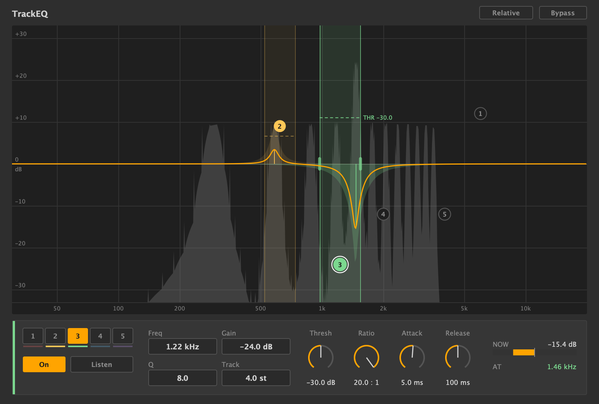

# TrackEQ — 周波数方向にも追従するダイナミック EQ (VST3)



コードは Claude Code (Anthropic の AI) が書き、MIDy が仕様を決めて Ableton Live で確認しました。
無保証です。不具合の報告は Issue で受け付けますが、返事や修正は約束しません。Pull Request は受け付けません。
ライセンスは AGPLv3 (LICENSE)。JUCE (AGPLv3) と VST3 SDK (MIT) を使っています。Copyright (C) 2026 MIDy

Made with Claude Code. Provided as-is. Bug reports via Issues are welcome, but replies and fixes are not promised. Pull requests are not accepted. Licensed under AGPLv3.

**ダウンロード**: Releases に Mac 版 (Intel / Apple Silicon 両対応) と Windows 版 (x64) の zip があります。

- Mac: `TrackEQ.vst3` を `~/Library/Audio/Plug-Ins/VST3/` に入れる。署名していないので、入れたあとターミナルで

  ```
  xattr -dr com.apple.quarantine ~/Library/Audio/Plug-Ins/VST3/TrackEQ.vst3
  ```

- Windows: `TrackEQ.vst3` フォルダごと `C:\Program Files\Common Files\VST3\` に入れる

## 何をするか

楽器やマイクの特性、部屋鳴りのせいで、特定の倍音だけ飛び出して聞こえることがある。その倍音は鳴らしている音程によって周波数が上下するので、固定のダイナミック EQ では追いきれない。

TrackEQ は 5 バンドのダイナミック EQ で、各バンドが「Freq を中心に ± Track 半音」の範囲の中でいちばん強い山 1 本を追いかけ、その山がしきい値を超えたときだけベルを動かす。範囲内の他の山は、ベルの裾がかかる分しか変わらない。Track を 0 にすると普通の (周波数が固定の) ダイナミック EQ になる。

レイテンシは 48 kHz で 1024 サンプル (約 21 ms)。DAW が自動で補正する。

## 操作

グラフ
- 点をドラッグ: 横 = Freq、縦 = Gain
- スクロール: Q (点の上か、そのバンドの範囲の中で)
- ピンチ、または範囲の端の縦線をドラッグ: Track
- 点線をドラッグ: Threshold (高さは背景のスペクトルと同じ目盛り。Relative がオンのときは出ない)
- 点をダブルクリック: そのバンドをオフ / オン
- 空いた所をダブルクリック: 空いているバンドをそこに置く

グラフの見方
- 色の薄い山: Gain いっぱいまで動いたときの形
- オレンジの線: 今実際にかかっているカーブ
- 縦の細い線: 今追っている位置

下の欄 (選んだバンド)
- 1〜5: バンドを選ぶ。On: オン / オフ。Listen: そのバンドが拾っている帯域だけを聴く
- Freq / Gain / Q / Track: 数字を上下にドラッグ
  - Gain: しきい値を超えたときに動かす最大量 (−30〜+30 dB)。マイナスで下げる、プラスで持ち上げる
  - Track: 追う幅 (半音、0〜12)。0 で追従なし
- Thresh: しきい値。Ratio: 超えた分をどれだけ動かすか。Attack / Release: 動き始めと戻りの速さ
- NOW: 今動かしている量。AT: 今追っている周波数

右上
- Relative: オンにすると、しきい値が「全体の音量に対して何 dB か」になる。演奏の強弱があっても、同じように飛び出した倍音に同じだけかかる
- Bypass

## 知っておくこと

- Q 8 で 15 dB 下げると、4 度離れた隣の倍音も 2.5〜3 dB 下がる (ベルの裾)。気になるなら Q を上げる
- 倍音の間隔が 70 Hz 前後より狭い音 (低いベースなど) は、山を分けて追えない見込み
- 和音でも動くが、追うのは範囲の中でいちばん強い 1 本だけ

## ビルド

CMake 3.22 以上。JUCE 8.0.15 は自動で取得する。

```
cmake -B build -DCMAKE_BUILD_TYPE=Release -DLAB_INSTALL=OFF
cmake --build build --config Release
```

検証 (DAW なし): `-DLAB_BUILD_TESTS=ON` で `TrackEQTest` ができる。引数なしで固有テスト、`TrackEQTest robust` で耐久テスト。
